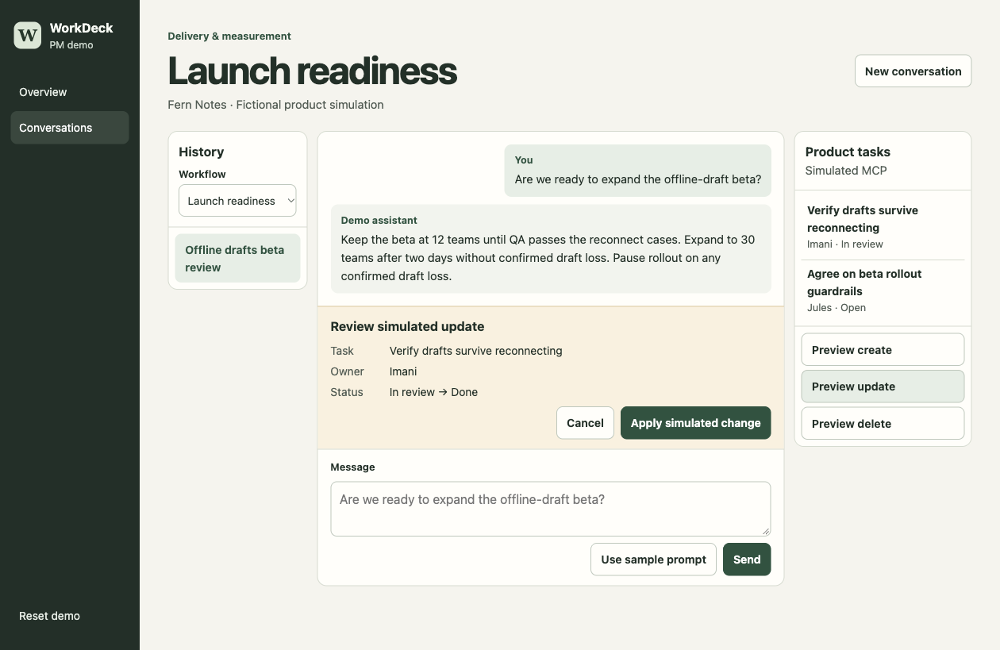

# WorkDeck

A local Codex skill and product manager simulation. Start a conversation from a workflow, reopen its history, and review simulated task changes before applying them.



## Try the product manager demo

Fern Notes is a fictional team notes app. Walk through five decisions about its offline drafts beta.

| Workflow | Example decision |
| --- | --- |
| Customer discovery | Decide which interview patterns need another round of evidence. |
| Prioritization | Compare offline drafts with shared editing for the beta. |
| Sprint planning | Define acceptance criteria for recovering a draft after a force-quit. |
| Launch readiness | Decide when to expand the beta and when to pause it. |
| Metrics review | Interpret first-cohort adoption and investigate failed recoveries. |

Clone or download this repository. From its root, run:

```bash
python3 -m http.server 4387 --bind 127.0.0.1 --directory workdeck/assets
```

Open [localhost:4387](http://127.0.0.1:4387). Choose **Launch readiness** and send the sample prompt. Open **History** to revisit a conversation. Try **Preview update** to see the existing and proposed task status.

The demo uses fictional product data, scripted replies, and simulated MCP operations. State is stored in the current browser. **Reset demo** restores the sample data. You only need Python 3 and a modern browser.

## Install the Codex skill

From this repository's root, copy `workdeck` into the destination project's `.agents/skills/` directory. When the destination is this repository, run:

```bash
mkdir -p .agents/skills
cp -R workdeck .agents/skills/
```

Open Codex in the destination project and ask “Use `$workdeck` to walk me through the launch readiness demo.” [Codex Skills documentation](https://developers.openai.com/codex/skills)

Adapt the fiction, workflows, and reply scripts in [app.js](workdeck/assets/app.js). The layout lives in [style.css](workdeck/assets/style.css).

[MIT License](LICENSE)
